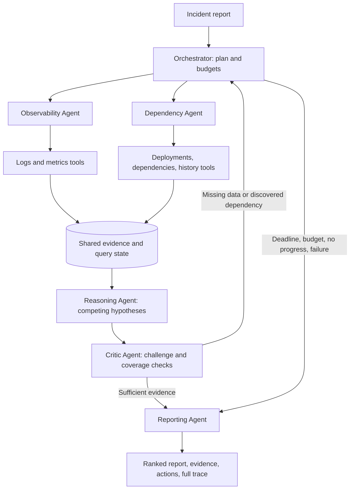

# Orange Incident Intelligence

An evidence-first investigation workspace by **Himanshi Rathore**.

**Live website: [Open Orange Incident Intelligence](https://himanshi252005.github.io/Multi-Agent-Production-Incident-Investigation-System/)**

Investigate production incidents with six specialist roles: Orchestrator, Observability, Dependency, Reasoning, Critic, and Reporting. Explore 18 synthetic scenarios, inspect supporting and contradicting evidence, follow live agent activity, import custom incident JSON, and export Markdown or JSON reports.

The public website runs the **deterministic TypeScript evidence engine entirely in your browser**. Imported evidence is not uploaded, and recent investigations stay in browser storage. No live LLM or production telemetry is connected. Google Fonts is loaded for typography.

## Assignment deliverables

| Requirement | Included material |
|---|---|
| 1. Runnable implementation and setup | [Python implementation](python/orange_investigator/), [detailed setup](python/README.md), and React website; commands below |
| 2. Architecture and agent coordination | Diagram below and [architecture document](python/docs/ARCHITECTURE.md) |
| 3. Synthetic dataset and automated tests | [18 incident fixtures](python/data/incidents.json), [separate evaluation labels](python/data/labels.json), [Python tests](python/tests/test_system.py), and [TypeScript parity tests](scripts/test-engine.mjs) |
| 4. Evaluation of both approaches | Comparison below, [evaluation report](python/results/benchmark/EVALUATION.md), [CSV](python/results/benchmark/evaluation.csv), and [JSON](python/results/benchmark/evaluation.json) |
| 5. Technical note, maximum 500 words | 419-word note below; [original core technical note](python/docs/TECHNICAL_NOTE.md) |

## 1. Runnable implementation with setup instructions

### Get the project

```sh
git clone https://github.com/Himanshi252005/Multi-Agent-Production-Incident-Investigation-System.git
cd Multi-Agent-Production-Incident-Investigation-System
```

### Run the Python investigation system

Requires **Python 3.11 or newer**. The offline implementation uses the standard library: no third-party packages or API key are required. From the repository root:

```sh
cd python
python -m orange_investigator list
python -m orange_investigator investigate --incident INC-004
python -m orange_investigator investigate --incident INC-004 --mode single
python -m unittest discover -s tests -v
```

On Windows, use `py -3` instead of `python` if needed. Investigation reports are printed and saved as JSON and Markdown under `python/results/latest/`. Try `INC-017` for a two-hop dependency failure or `INC-010` for competing explanations. See an [example report](python/results/demo/INC-017.md).

The Python system also includes an optional OpenAI adapter. Configuration is documented in the [Python setup guide](python/README.md#offline-and-live-modes). Its live API execution has not been verified; the adapter is tested with mocks. Keep API keys outside the frontend.

### Run the website

Requires **Node.js 22.13 or newer**. In a terminal at the repository root:

```sh
npm ci
npm run dev
```

To verify and produce the static website:

```sh
npm test
npm run build
npm run preview
```

The build writes `docs/`. GitHub Pages publishes **main → /docs**. After changing source, rebuild and commit both source and `docs/`. Use the full live URL above: this is a project website under the repository's name.

## 2. Architecture diagram and agent coordination



| Agent | Responsibility |
|---|---|
| Orchestrator | Creates the task graph, routes follow-ups, enforces budgets, retries, and termination. |
| Observability | Collects logs and metrics, including evidence IDs and source completeness. |
| Dependency | Collects deployment changes, dependency edges, and historical incident context. |
| Reasoning | Ranks competing hypotheses using supporting and contradicting observations. |
| Critic | Challenges conclusions and requests missing evidence or newly discovered dependencies. |
| Reporting | Produces a cited report with uncertainty, recommended actions, and verification steps. |

The two collectors run concurrently using `asyncio.gather`; Reasoning waits for both to finish or exhaust retries. Agents exchange typed results through a shared investigation state containing immutable evidence, query completeness, hypotheses, task status, and an event trace.

The critic's requests return to the orchestrator for targeted collection and another reasoning round. For example, `INC-017` reveals **checkout → inventory → warehouse** across successive rounds. The system stops when evidence is sufficient or when a deadline, budget, repeated state, or unrecoverable failure requires an inconclusive report.

Five simulated tools cover **logs, metrics, deployments/configuration, dependencies, and historical incidents**. Remediation is recommended, never executed.

See [full coordination, reliability, and termination details](python/docs/ARCHITECTURE.md).

## 3. Synthetic incident dataset and automated tests

The **18 synthetic incidents** cover deployment regressions, dependency failures, misleading changes, conflicting evidence, incomplete telemetry, multiple dependency hops, timeouts, retries, permanent failures, and untrusted log text.

- [Incident dataset](python/data/incidents.json): incident context and tool-visible observations.
- [Evaluation labels](python/data/labels.json): expected outcomes loaded only by the evaluator, not supplied to agents.
- [Dataset generator](python/data/generate_dataset.py): reproducible fixture creation.
- [Data contract](python/docs/DATA_CONTRACT.md): evidence fields, reliability, time windows, and fault scripts.
- [Python automated tests](python/tests/test_system.py): orchestration, grounding, retries, budgets, ambiguity, and mocked live-adapter behavior.
- [TypeScript parity suite](scripts/test-engine.mjs): **54 comparisons** (18 incidents × 3 approaches) against Python, plus **8 additional checks** for validation, budgets, identity independence, and evidence handling.
- [Verification record](python/docs/VERIFICATION.md).

Run Python tests from `python/` with `python -m unittest discover -s tests -v`; run browser-engine tests from the repository root with `npm test`.

## 4. Evaluation results comparing both approaches

The recorded offline benchmark uses **18 incidents × 3 repetitions × 3 modes = 162 runs**, measured with Python 3.12.14.

| Approach | Root-cause accuracy* | Accuracy including abstentions | Citation validity | Rule grounding | Mean tool calls | Median latency | Mean LLM tokens |
|---|---:|---:|---:|---:|---:|---:|---:|
| Multi-agent team | 100.0% | 100.0% | 100.0% | 100.0% | 6.56 | 16.73 ms | 0 |
| Single-agent baseline | 73.3% | 77.8% | 100.0% | 100.0% | 5.33 | 79.02 ms | 0 |
| Sequential adaptive team | 100.0% | 100.0% | 100.0% | 100.0% | 6.56 | 80.36 ms | 0 |

*Root-cause accuracy excludes intentionally inconclusive cases; overall accuracy includes correct abstentions.*

The **single-agent baseline** queries the same five tools sequentially and reasons once, without critic feedback or follow-up retrieval. The **multi-agent team** adds parallel collectors and targeted feedback. The **sequential adaptive team** preserves that feedback but executes sequentially, separating retrieval-policy benefits from parallel scheduling.

All approaches use the same fixtures, inference engine, retry policy, and budgets, with reset fault counters. Citation validity checks referenced evidence exists; rule grounding checks signed-rule consistency. Neither establishes independent causal truth.

**Interpretation:** these are synthetic, co-designed fixtures and rules with simulated source latency. The scores demonstrate functional behavior, not real-world generalization or LLM quality. Offline token use is zero because no language model is called.

Reproduce the benchmark from `python/`:

```sh
python -m orange_investigator evaluate --repeats 3 --output results/my-benchmark
```

[Evaluation methodology](python/results/benchmark/EVALUATION.md) · [Raw CSV](python/results/benchmark/evaluation.csv) · [Raw JSON](python/results/benchmark/evaluation.json). Rerunning evaluation also generates per-incident traces.

## 5. Technical note — 419 words

The Python core prioritizes an inspectable investigation process. Six agents collaborate through typed messages, an explicit task graph and shared evidence state. Observability and Dependency agents collect independently; Reasoning waits for both. Critic checks source coverage, competing explanations and newly discovered dependencies, then sends targeted queries back through the Orchestrator. Reporting preserves citations, counter-evidence and uncertainty.

Python's standard library keeps setup reproducible without a framework or API credential. The default engine is symbolic, using general diagnostic rules over normalized telemetry. It is not presented as an LLM. Optional OpenAI mode uses structured model outputs for hypothesis generation and critic review, with citation and schema validation. Model failures remain visible and never silently switch inference providers.

Evidence is immutable and keyed by source IDs. Repeated signals do not inflate confidence, historical similarity does not prove current causation, and positive and negative observations remain separate. Confidence is heuristic, not calibrated probability. A diagnosis needs independent source families and separation from alternatives; ambiguous or exhausted investigations remain inconclusive. Recommended changes are never executed automatically.

Each tool call reserves a shared budget slot before awaiting work. Per-source timeouts, bounded retries, per-agent retries, round limits, no-progress detection and an overall deadline prevent unbounded investigations. Partial responses trigger follow-up rather than being treated as complete. The standard-library HTTP adapter uses a worker thread; cancellation cannot forcibly stop an in-flight socket request, which may continue until its bounded timeout.

Eighteen synthetic incidents include misleading changes, conflicting observations, incomplete telemetry, dependency propagation, failures and untrusted log text. The single-agent baseline uses the same tools and inference implementation but investigates in one pass. A sequential version of the adaptive team controls for scheduling effects. Results record accuracy, citation validity, signed-rule grounding, calls, latency and actual model usage when available. Offline token consumption is zero. Missing usage after a failed live request is explicitly marked unknown.

The dataset and rules were co-designed, so high offline scores demonstrate functional behavior, not real-world generalization. Grounding metrics check citations and rule consistency, not independent causal truth. The live adapter is mock-tested but was not executed against an API in this delivery. Current limitations include the finite cause catalog, normalized telemetry assumptions, fixture-defined reliability, in-memory state and no production connectors. Next steps are held-out incident evaluation, calibrated confidence, semantic citation review, real telemetry adapters, durable task execution and an asynchronous network transport with cooperative cancellation.

The companion React website runs the deterministic TypeScript engine in the browser, with local history and report exports. It does not connect to the optional live LLM adapter.

## Repository layout

- `app/`: React interface and responsive styles.
- `lib/`: TypeScript evidence engine, browser transport, domain rules, and fixtures.
- `tests/` and `scripts/`: engine parity checks.
- `public/`: favicon and example incident.
- `docs/`: built website published by GitHub Pages.
- `python/`: original implementation, dataset, tests, architecture, benchmark, and technical note.
