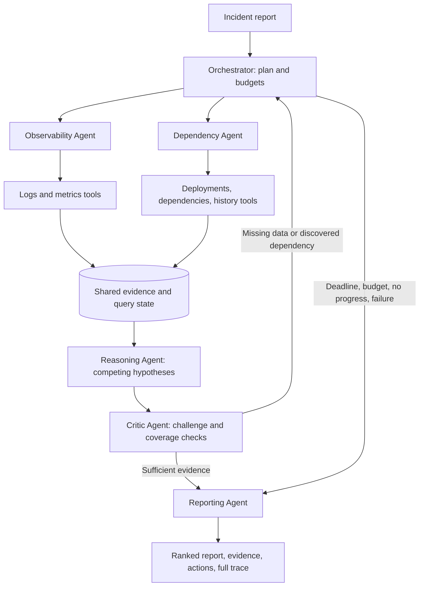

# Architecture and coordination

## Agents have separate responsibilities

| Agent | Inputs | Structured result | Decision responsibility |
|---|---|---|---|
| Orchestrator | Incident, configuration, previous critique | Task graph and routed requests | Parallel/serial scheduling, retries, budget enforcement, termination |
| Observability | Log/metric queries | `AgentResult` with retrieved evidence IDs | Executes source-specific investigations and reports completeness |
| Dependency | Deployment, dependency and history queries | `AgentResult` with retrieved evidence IDs | Establishes observed topology and change context |
| Reasoning | Shared evidence snapshot | Ranked `Hypothesis` objects | Competing explanations, support, contradiction, assumptions |
| Critic | Hypotheses, source completeness, observed topology | `Critique(accepted, concerns, requests)` | Independent source-coverage checks and directed follow-up |
| Reporting | Final shared state and execution records | JSON and Markdown reports | Faithful evidence presentation, abstention, conditional recommendations |

The collectors operate concurrently using `asyncio.gather`. Reasoning has explicit dependencies on both collection tasks. It begins only after both complete or exhaust retries. The critic consumes the resulting hypotheses and completeness records. Follow-up queries are not a fixed second prompt: they are structured tasks determined from newly observed dependency edges, failures and truncation. The orchestrator routes each task to its owner and starts another collection/inference round.

For example, INC-017 initially reveals checkout → inventory. The critic requests inventory logs, metrics and dependencies; those reveal inventory → warehouse. A second feedback pass requests warehouse evidence before the report selects dependency outage. Initial symptom logs alone do not establish that conclusion.

## Shared state and evidence

`InvestigationState` stores immutable evidence by ID, latest query completeness, typed agent messages, hypotheses, task statuses and a chronological event trace. Updates occur synchronously in the event loop. A tool attempt reserves its global call slot before its first await, so parallel tasks cannot overspend the budget. Evidence cannot change under an existing ID. Conflicting observations must retain distinct IDs and remain visible.

The toolbox filters by source, service, time window and limit. Initial queries request up to three records. Truncation and simulated partial responses mark completeness false. Critic queries request up to 100 records; if a larger result set remains incomplete, the engine stops safely rather than claiming full coverage. Dependency expansion uses only observed `depends_on` evidence and can traverse multiple hops within the round budget.

## Reasoning and review

Offline mode is a symbolic diagnostic reference implementation. General rules assign signed support weights; source reliability scales each vote, and repeated service/code/polarity signals are deduplicated. A cause needs at least two independent source families, minimum net support, and sufficient separation from competing causes. Historical reports do not contribute direct causal support.

Live mode replaces hypothesis generation and extends critic review with structured LLM responses. The adapter validates the schema, known cause IDs, evidence IDs, nonempty support, overlapping citations, duplicate hypotheses, and permitted services in follow-up requests. Deterministic source-coverage gates still apply. These checks protect structural grounding, not the semantic truth of every model interpretation. Unknown causes are outside the current catalog.

## Reliability and termination

Tools simulate timeout, connection failure, partial data or success. Fault scripts advance per source/service attempt; their final outcome repeats. Tool retries use bounded exponential backoff. Agent retries reuse the shared state and global budgets, preserving completed evidence and the failure trace. Exhausted collector retries leave gaps for the critic to revisit; exhausted reasoning or critic retries produce an inconclusive report.

Termination conditions are sufficient evidence, unsupported/ambiguous conclusions with no productive follow-up, tool budget, round budget, deadline, repeated state with no progress, or unrecoverable reasoning/critic failure. A reporter always assembles the available evidence. Reports distinguish a probable cause from a proven causal fact, and preserve uncertainty even when a hypothesis ranks first.

The overall timeout cancels pending asyncio work. Standard-library HTTP requests run in worker threads and cannot be forcibly cancelled; socket timeouts bound this remaining work. Live usage from interrupted requests may be unknown and is labeled accordingly.

## Comparison design

`SingleAgent` owns a fixed sequence of the same five tool queries and one inference call. It uses the same inference code, schema, prompt, source data and tool retry policy. It has no collector hand-offs, critic or feedback. `sequential-adaptive` is a scheduling ablation of the agent team with the same feedback policy, not another single-agent implementation. All modes reset source fault counters and use equal budgets. The benchmark rotates mode order between repetitions.

Expected labels are loaded only by the evaluator, after they have been separated from runtime fixtures. Agents receive an incident and tool-visible observations; no runtime rule references a case ID or oracle label.
